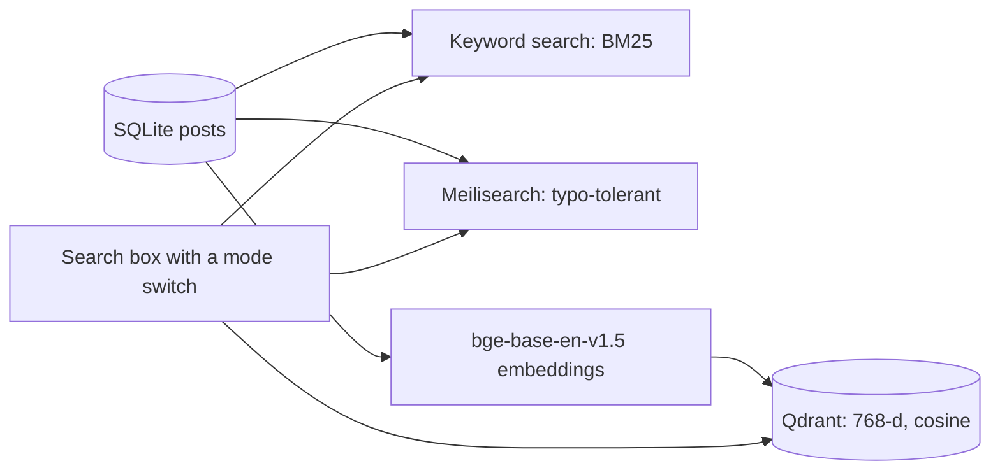

# vault-semantic-search

Semantic (vector) search for **VAULT**, a personal archive viewer with a Node/TypeScript server, a React UI and a SQLite database. Posts are embedded with a sentence-transformers model and stored in Qdrant, next to the existing keyword and typo-tolerant search.

This repository contains the indexing and search scripts and a test. The scripts read from a SQLite database of posts (set with `VAULT_DB`).

## Search modes in VAULT



The text embedded for each post is `caption + hashtags + username + music title + the first 300 characters of the comments`. Vectors are normalized and compared with cosine distance.

## Index runs

| Date | Where | Result |
|---|---|---|
| 25 to 26 Jun 2026 | Hugging Face Space | Meilisearch and the embedding model ready, 1,171 posts indexed for typo-tolerant search |
| 28 Jun 2026 | Colab (GPU) | Qdrant collection `posts`: green, 541 points, 768 dimensions, cosine; Meilisearch: 541 documents |

## Scripts

| File | Purpose |
|---|---|
| `scripts/common.py` | Settings from environment variables and shared helpers |
| `scripts/build_index.py` | Embeds all posts and (re)creates the Qdrant collection |
| `scripts/index_new_posts.py` | Embeds only the posts that are not in Qdrant yet (reads the collection page by page) |
| `scripts/search.py` | Semantic search from the command line |
| `scripts/start_qdrant.sh` | Starts a Qdrant server for Colab or a Hugging Face Space |
| `tests/test_plumbing.py` | Tests build, incremental indexing, pagination and search with an in-memory Qdrant and a stand-in encoder |

Settings (environment): `VAULT_DB`, `QDRANT_URL` (`:memory:` for in-process), `EMBED_MODEL` (default `BAAI/bge-base-en-v1.5`), `COLLECTION`.

```bash
pip install -r requirements.txt
python tests/test_plumbing.py                       # no GPU, no server

./scripts/start_qdrant.sh                           # needs the qdrant binary
VAULT_DB=vault.db python scripts/build_index.py     # GPU recommended
python scripts/search.py "girl dancing"
```

The `posts` table needs the columns `post_id, username, caption, hashtags, comments_text, categories, music_title`.

## Troubleshooting

| Symptom | Cause and fix |
|---|---|
| `Qdrant not running?` | Start the server first (`scripts/start_qdrant.sh`) |
| Meilisearch sync: `no such column: description` | The sync query must only use columns that exist in `posts` |
| `Attribute category is not filterable` | Meilisearch filters work only on declared attributes (`categories`, `platform`) |
| `Blocked request` when exposing the app from Colab | Add the host to the dev server's `allowedHosts` |


## License

MIT
